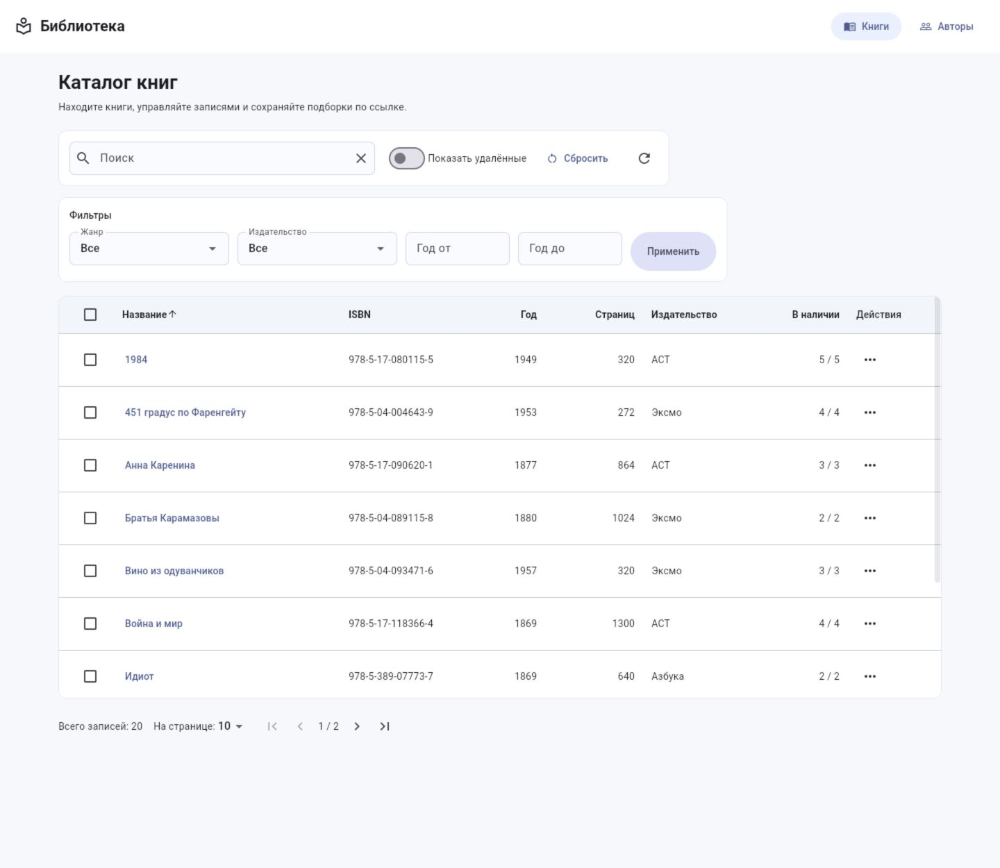
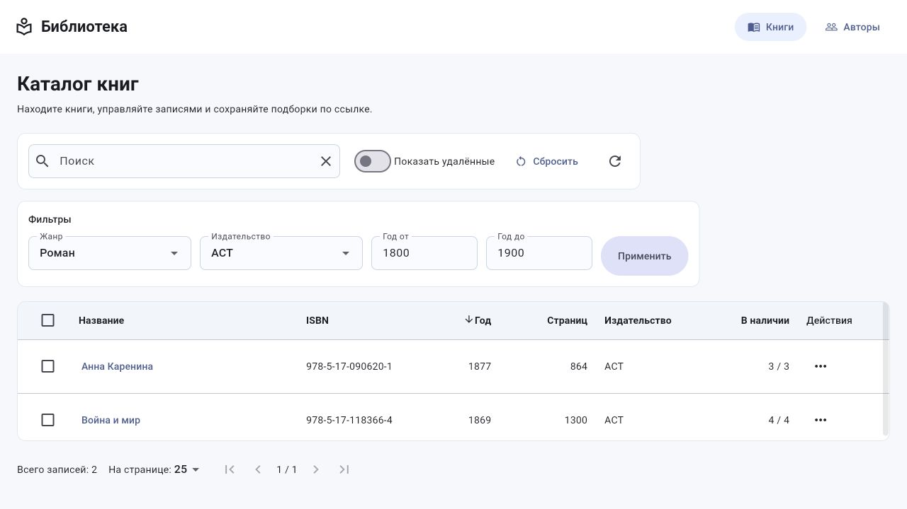
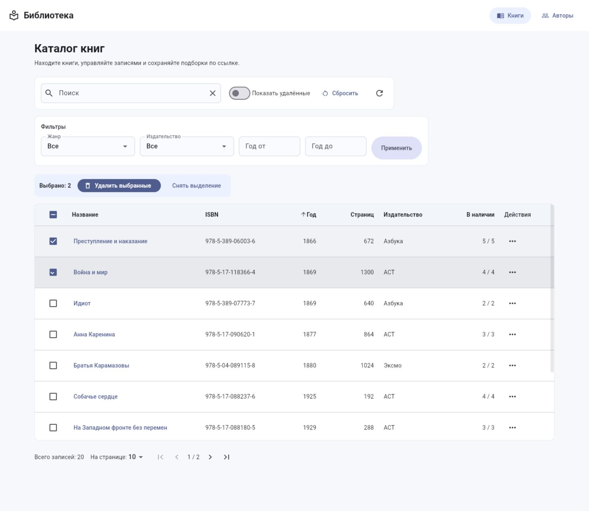
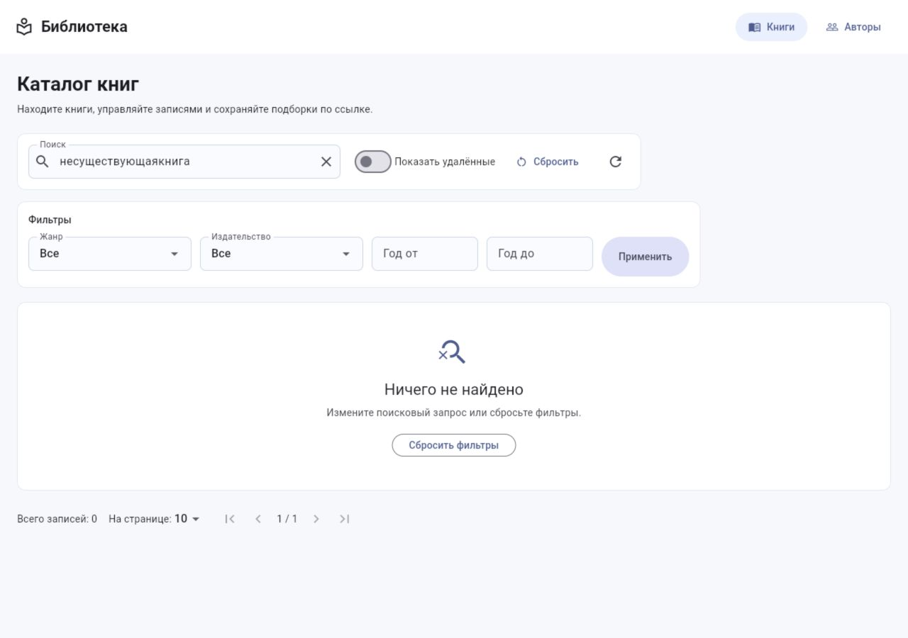
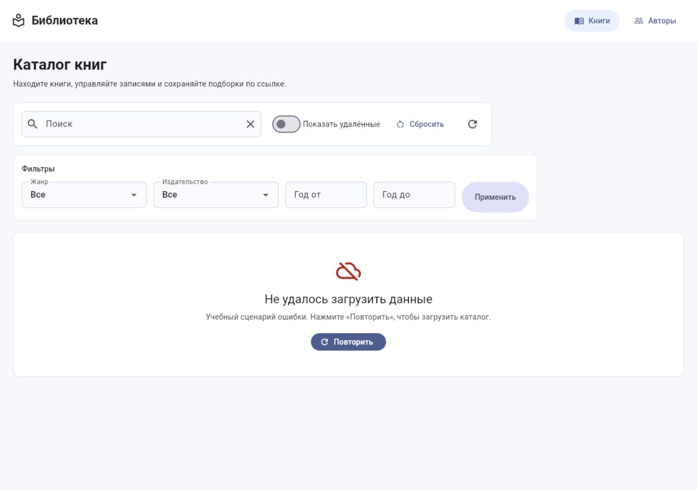

# Практическая работа №2

**Тема:** списки, поиск, фильтрация и пагинация.

**Цель:** освоить управление состоянием через provider, разделение приложения на слои и работу с каталогом книг и авторов на данных в памяти.

## Ход работы

1. Создаём Flutter Web проект library_app и подключаем пакеты provider, go_router и flutter_web_plugins. Настраиваем маршруты каталога книг, списка авторов и карточек записей.

2. В файлах models/book.dart и models/author.dart описываем неизменяемые модели предметной области. Метод copyWith создаёт изменённую копию записи, а deletedAt отмечает логическое удаление.

3. В models/page_result.dart создаём обобщённый класс PageResult<T>. Он хранит записи текущей страницы, номер и размер страницы, общее количество записей и вычисляет количество страниц.

4. В models/list_query.dart и models/book_query.dart описываем параметры поиска, сортировки и фильтрации. Добавляем преобразование параметров в URL и обратное восстановление; при изменении условий возвращаемся на первую страницу.

5. В data/seed_data.dart подготавливаем 20 книг и 8 авторов, а также справочники жанров и издательств. При полной перезагрузке приложения данные возвращаются к начальному набору.

6. В repositories/entity_repository.dart описываем интерфейсы репозиториев. В in_memory_repository.dart реализуем хранение записей, постраничную выдачу, логическое и физическое удаление, восстановление и множественное удаление.

7. В репозиториях книг и авторов настраиваем условия отбора и сравнение записей. Поиск книг работает по названию и ISBN, поиск авторов — по ФИО и стране; регистр символов не влияет на результат.

8. В state/entity_list_notifier.dart создаём состояние списка: параметры запроса, результат, этап загрузки, сообщение об ошибке и набор выбранных записей. BookListNotifier и AuthorListNotifier связывают общее состояние с соответствующими моделями и репозиториями.

9. В widgets/entity_table.dart создаём обобщённую таблицу EntityTable<T>. Колонки задаются через TableColumnSpec<T>; таблица поддерживает сортировку, флажки выбора и прокрутку по двум осям.

Рисунок 1 — Список книг в виде таблицы.

10. В screens/catalog_screen.dart реализуем общую логику экрана каталога, поиск с задержкой 400 мс и синхронизацию параметров с адресом. В экранах книг и авторов задаём заголовки, колонки и отображаемые поля.

11. В widgets/book_filters.dart добавляем совместные фильтры по жанру, издательству и диапазону годов. Проверяем корректность ввода годов, затем применяем условия одной кнопкой.

Рисунок 2 — Применение фильтров и сортировки.

12. При ширине окна менее 600 пикселей заменяем таблицу списком карточек. Сохраняем поиск, фильтры, выделение записей и меню действий.

Рисунок 3 — Каталог в мобильной раскладке.

13. Добавляем множественный выбор, счётчик выбранных записей и диалог подтверждения удаления. Логически удалённые записи доступны при включении переключателя «Показать удалённые»; из меню записи можно выполнить восстановление или физическое удаление.

Рисунок 4 — Выбор нескольких записей.

14. В widgets/pagination_bar.dart размещаем выбор размера страницы 10, 25 или 50 и кнопки перехода на первую, предыдущую, следующую и последнюю страницы. После удаления последней страницы корректируем номер страницы и адрес.

15. Реализуем отдельное отображение загрузки, успешного результата, пустого списка и ошибки. Для воспроизводимой демонстрации ошибки добавляем учебный параметр __fail=500 и кнопку повторного запроса.

Рисунок 5 — Пустой результат поиска.

Рисунок 6 — Ошибка загрузки и повторный запрос.

16. Проверяем переходы в карточки книг и авторов, возврат к параметрам списка и восстановление условий по ссылке в новой вкладке. Кнопки браузера «назад» и «вперёд» восстанавливают предыдущие условия.

17. Запускаем анализатор, автоматические тесты репозиториев, состояния и интерфейса, затем собираем web-версию и проверяем её в браузере.

## Исправление ошибки deleteMany

В исходном примере использовалось условие:

    final i = _books.indexWhere((b) => b.id == id && !b[i].isDeleted);

Здесь b — отдельный объект Book, к которому нельзя обращаться как к списку через b[i]. Кроме того, i используется внутри выражения, которое должно только вычислить его значение. В варианте с indexWhere правильное условие: b.id == id && !b.isDeleted.

В приложении применяется общий алгоритм для обеих сущностей: идентификаторы преобразуются в Set, затем список обходится по индексу. Если идентификатор записи выбран и запись ещё не удалена, создаётся её копия с deletedAt. Повторяющиеся ID не увеличивают счётчик, отсутствующие и уже удалённые записи пропускаются.

## Схема слоёв

    main.dart / router.dart — сборка зависимостей и маршрутов
                    ↓
    screens + widgets — пользовательский интерфейс
                    ↓
    state — ChangeNotifier, параметры, загрузка и выделение
                    ↓
    repositories — интерфейсы и реализация в памяти
                    ↓
    data — начальный набор записей

    models — общие типы данных для перечисленных слоёв

Виджеты получают состояние через provider и вызывают его методы. Вызовы репозитория сосредоточены в слое state. Локальный setState используется только для черновых значений полей фильтра.

## Почему используется EntityTable<T>

Таблицы книг и авторов различаются набором колонок, но одинаково обрабатывают выделение строк, сортировку, действия и прокрутку. Обобщённый тип T позволяет описать это поведение один раз и сохранить проверку типов: EntityTable<Book> принимает книги, EntityTable<Author> — авторов. Для нового справочника достаточно передать свои колонки и обработчики.

## Параметры в адресе

Пример адреса с совместными фильтрами:

    /books?genreId=1&publisherId=1&yearFrom=1800&yearTo=1900&sort=year,desc&page=1&size=25

Параметры search, genreId, publisherId, yearFrom, yearTo, sort, page, size и includeDeleted восстанавливаются из URL. Поисковая строка кодируется штатным классом Uri.

Снимки в этом файле показывают содержимое приложения. Для требуемого заданием снимка адресной строки нужно открыть приведённую ссылку в браузере и захватить окно вместе с адресной строкой.

## Вывод

Реализован каталог книг и авторов с разделением на слои, управлением состоянием через provider, адаптивной раскладкой, поиском, совместными фильтрами, сортировкой, пагинацией и операциями удаления. Параметры списка сохраняются в URL и восстанавливаются при навигации браузера.
